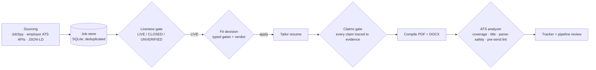

# Job Search Pipeline

A local-first pipeline that sources job postings, checks whether each one is still open, decides whether it is worth applying to, and tailors a resume that is both honest and ATS-readable. It comes with a Streamlit UI that runs every stage on a fictional demo candidate.

I built it for my own job search across Ireland and India. Every gate in it exists because something went wrong without it: a resume built for a role that had already closed, a skill claimed that wasn't backed by real work, a send file whose name told one employer where else I was applying.

## What it does



| Stage | Module | What it checks |
|---|---|---|
| Sourcing | `jobspy_fetch.py`, `ats_harvest/` | Indeed and LinkedIn through JobSpy, plus 10 ATS adapters (Greenhouse, Lever, Ashby, Workday, Workable, SmartRecruiters, Recruitee, Teamtailor, Personio, Oracle Recruiting Cloud) that read employers' own public job APIs with true posting dates |
| Job store | `job_store.py` | One SQLite store, deduplicated on a normalised URL. Tracking parameters are stripped but board-specific ids are kept (an Indeed job's identity *is* its `jk=` query parameter) |
| Liveness | `check_live.py`, `employer_verify.py` | A page that renders is not a role that is open. LinkedIn serves closed postings with HTTP 200, so the check looks for closed markers and missing Apply buttons, flags reposts, and confirms the title on the employer's own board |
| Fit decision | `fit_decision.py` | Typed yes/no gates with confidence for the knockouts that matter: visa wording, the years bar, seniority in the title, a salary trap hidden in prose, Northern Ireland postings returned by "Ireland" searches. Returns `APPLY_TIER1` / `APPLY_TIER2` / `STRETCH` / `SKIP` |
| Claims gate | `verify_claims.py` | Every tool under Experience must appear in the claims file at the right tier. A portfolio-only tool listed as work experience is blocked |
| Compile | `compile_docs.py` | Markdown to A4 PDF and DOCX. Send filenames name the candidate and a specialisation, never the employer, and stay under 55 characters |
| ATS analyzer | `ats_analyzer.py`, `ats_score.py` | Weighted coverage of the JD's own terms with must-haves boosted, title match, parse-safety lint on the compiled PDF, and a pre-send lint for em dashes, buzzwords and a missing phone number. Gaps are split into terms the candidate can honestly add and terms they don't have |
| Review | `pipeline_review.py` | Normalises free-text tracker statuses into real states and measures the funnel from actual outcomes |

## Run it

```bash
pip install -r requirements.txt
make ui          # seeds the demo job store and opens the Streamlit app
make checks      # every regression suite, the same thing CI runs
```

Command-line equivalents:

```bash
make ats RESUME=examples/resume.md JD=examples/jd_data_analyst.txt
make fit JD=examples/jd_knockout.txt
make verify RESUME=examples/resume.md
make live URL=https://boards.greenhouse.io/<company>/jobs/<id>
```

Live sourcing is optional (`pip install -r requirements-sourcing.txt`, then `make source` or `make harvest`).

## Using it for yourself

Everything personal lives in `data/`:

- `data/profile.json`: name (used for send filenames), years of experience, salary floor, work permission, past employers
- `data/master_experience_claims.json`: the evidence file every resume claim must trace to, split into production experience, working proficiency and actively building
- `data/application_tracker.csv`: your applications

The repo ships with a fictional candidate (Alex Morgan) so it runs out of the box.

## Design choices

- **Local-first.** No JD, resume or claim text is sent to a hosted model. The only network calls are fetching public job pages and public ATS APIs.
- **Regression suites for tools whose wrong answers are expensive.** A filter that silently returns the wrong row is more dangerous than one that errors. The job store, ATS adapters, JSON-LD reader, compile rules and employer matching each have a pinned suite.
- **No scraping behind logins or bot checks.** Sources are public guest endpoints and the same public APIs employers' own career sites call.
- **Moderate tailoring, not keyword mirroring.** The analyzer targets honest coverage, not a 100% score; a resume that mirrors a JD word for word reads as machine-written.

## Stack

Python, SQLite, pandas, Streamlit, python-docx, ReportLab, pdfplumber, GitHub Actions.

---

Built by [Shreyas Sudarshanam](https://github.com/Shreyas1432).
